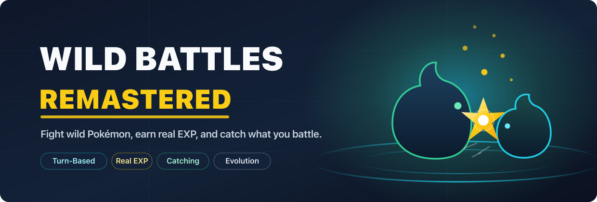
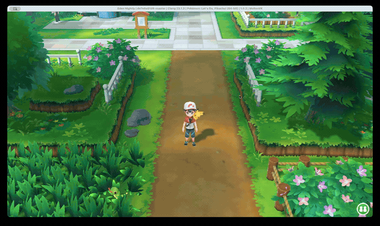
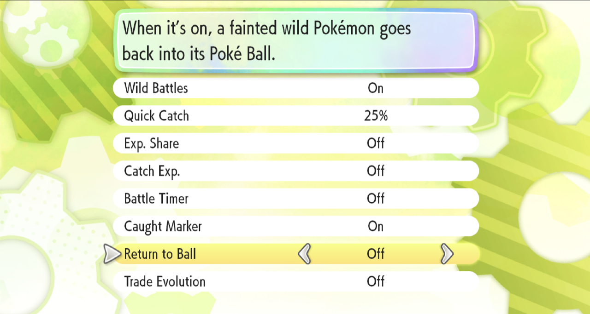

  

<h1 align="center">Pokémon Let's Go: Wild Battles Remastered</h1>

  <b>Real turn-based wild battles, with EXP and catching, for Pokémon: Let's Go, Pikachu! and Let's Go, Eevee!</b> 
  v1.0.0-beta · for game version 1.0.2 of either game  
  <a href="https://avishay.co.il/pokemon-letsgo-wild-battles-remastered/"><b>Website</b></a> ·
  <a href="https://avishay.co.il/pokemon-letsgo-wild-battles-remastered/install.html"><b>Install guide</b></a> ·
  <a href="https://avishay.co.il/pokemon-letsgo-wild-battles-remastered/testing.html"><b>Testing</b></a> ·
  <a href="../../releases"><b>Download</b></a>

  

---

In the original *Let's Go*, you don't battle wild Pokémon. You throw balls at them in the overworld.
Wild Battles Remastered brings back turn-based wild battles: your team earns real EXP for a knockout,
and you can still catch what you battle.

## What you get

- Turn-based wild battles. Walk into a wild Pokémon and fight it the classic way, with the full
  Fight / Pokémon / Bag menu.
- Real EXP for a knockout: the game's own EXP amounts, level-ups, new moves and evolutions.
- Only the Pokémon that battled earn EXP, in every battle, wild and Trainer alike. A teammate you switch
  in shares it; the rest of the team gets nothing.
- Catch what you battle. Bring a wild Pokémon down to 25% HP or less, press **Y**, and throw a ball in the
  game's own catch scene.
- Catching gives no EXP. EXP comes from battling. The catch summary (with its candy reward) still shows,
  but no one levels up from a catch.
- No 5-minute battle timer, and no "return to ball" animation when a wild Pokémon faints.
- A caught marker: a Poké Ball beside the wild Pokémon's HP box means you've caught that species before.
- Trade evolutions without trading (optional, starts Off). Kadabra, Machoke, Graveler and Haunter can
  evolve by levelling up from a level you choose.
- Snorlax and the Legendaries play as in the original game. The mod's battle changes only apply to its
  own wild battles.
- It works from the start of a new game, before "Play with Pikachu/Eevee" is unlocked: your partner shows
  up and battles normally.
- Both games, on an emulator (Eden) or a modded Switch (Atmosphère).

## Settings in the game

  

You can change everything above in the game at any time. Open **Options**, go to the last row,
**Wild Battles Settings**, and press **A** (or left or right) on it to open the mod's own page. **B** takes you back,
and the game asks whether to keep your changes. Your choices are kept in your save file.

| Setting | Choices | Starts at |
|---|---|---|
| Wild Battles | On · Off (Off = the game's normal catching) | On |
| Quick Catch | Off · 25% · 50% · Any HP (press **Y** at or below that HP) | 25% |
| Exp. Share | Off (only battlers) · Trainers (whole party in Trainer battles) · On (whole party) | Off |
| Catch Exp. | On (the game's normal catch EXP) · Off (no EXP from catching) | Off |
| Battle Timer | On (the game's 5-minute limit in wild battles) · Off | Off |
| Caught Marker | On · Off | On |
| Return to Ball | On (the recall animation when a wild Pokémon faints) · Off | Off |
| Trade Evolution | Off · Lv. 30 · Lv. 40 · Lv. 50 | Off |

The page follows your game's language (all ten). We wrote the English text and translated the other
languages ourselves, so corrections are welcome in [Issues](../../issues).

## Get started

1. Download the zip for your game and where you play from the [Releases](../../releases) page:

   | Your game | Emulator (Eden) | Modded Switch (Atmosphère) |
   |---|---|---|
   | *Pokémon: Let's Go, Pikachu!* | `WildBattlesRemastered-v1.0.0-beta.zip` | `WildBattlesRemastered-Atmosphere-v1.0.0-beta.zip` |
   | *Pokémon: Let's Go, Eevee!* | `WildBattlesRemastered-Eevee-v1.0.0-beta.zip` | `WildBattlesRemastered-Eevee-Atmosphere-v1.0.0-beta.zip` |

2. Follow the short [installation guide](docs/HOW_TO_USE.md).
3. Back up your save, enable the mod, and go find a wild Pokémon.

You need *Pokémon: Let's Go, Pikachu!* or *Let's Go, Eevee!*, version 1.0.2, from your own legally owned
copy. Use the zip for your game: each mod only works on its own game. The mod was developed and tested
on [Eden](https://git.eden-emu.dev/eden-emu/eden). The Atmosphère version is the same patch in the format
Atmosphère loads, and nobody has tested it on a real Switch yet. This project includes no game files.

## Known limitations (beta)

- Legendary and special encounters (Snorlax, the legendary birds, Mewtwo, the Power Plant Electrode)
  were checked against the game's code to play as in the original, but nobody has played one with this
  mod yet. Save before one.
- A real Switch (Atmosphère) is untested. Testers are welcome.
- After a catch, an empty party bar shows for a moment before you return to the overworld. That's the
  game's own "no EXP to give" screen.
- Only tested on Eden. Other emulators that load `.pchtxt` patches should work but are untested.
- *Let's Go, Eevee!* was played from the start of the game through its first routes (wild battles,
  catching, running, losing, a Trainer battle and the settings page); the rest of its story hasn't been
  played yet.

The [testing page](https://avishay.co.il/pokemon-letsgo-wild-battles-remastered/testing.html) lists every
check played on this release, and what still needs testers.

Found a problem? Open an issue on the [Issues](../../issues) page with what you did and what happened.

## For developers

The mod is generated, not hand-written: `tools/build_patch.py` emits every byte of the `.pchtxt` from
the game's own code and self-checks each patch before writing it. The committed mods in
[`mods/`](mods/) are pinned by [`build-manifest.json`](build-manifest.json) (Pikachu) and
[`build-manifest.eevee.json`](build-manifest.eevee.json) (Eevee), and CI checks that they match. Both
games are built from the same source, so the Eevee mod is the Pikachu mod with every address moved
through a generated shift table ([`tools/game_maps.py`](tools/game_maps.py)). To rebuild it from your
own dump, see [Building from source](docs/BUILDING.md).

## Credits

This project builds on others' work: Rico Santos' original *Wild Battles* and *Win or Catch* mods
showed what was possible, raulzrrs' *letsgo-recomp* documented how the game's battles
work, feelingdev's *The Better Let's Go* showed that the game's Options menu can carry a mod's settings,
and the research used free tools such as Eden, Ghidra and Capstone. [CREDITS](CREDITS.md) lists everyone,
with links.

## Legal

A free, non-commercial fan project. It ships no game code, ROMs or keys; you need your own legal copy of
the game. See [DISCLAIMER](DISCLAIMER.md) and [LICENSE](LICENSE.md).
